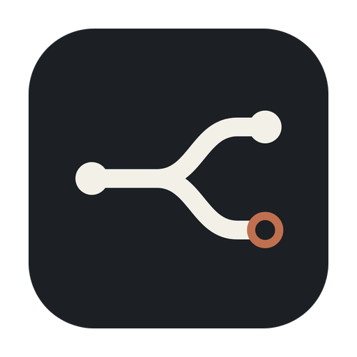
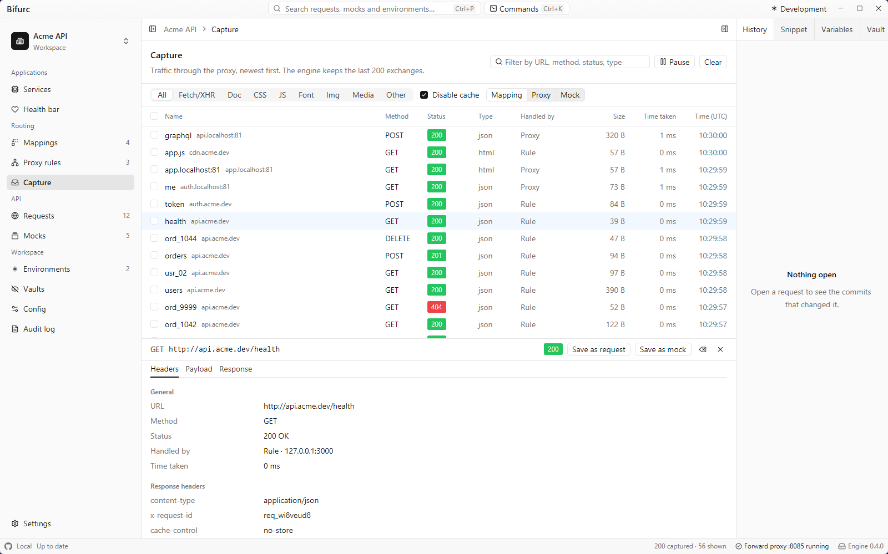
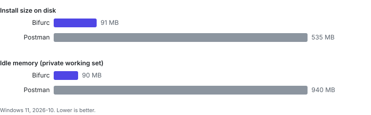

<p align="center">
  
</p>

<h1 align="center">Bifurc</h1>

<p align="center"><b>The local-first workspace for your APIs and your localhost: send requests, capture traffic, mock and rewrite it, all in files you can put in git.</b></p>

<p align="center">
  <a href="https://github.com/HarshalKudale/bifurc/actions/workflows/ci.yml"></a>
  <a href="https://github.com/HarshalKudale/bifurc/releases/latest"></a>
  <a href="https://github.com/HarshalKudale/bifurc/releases"></a>
  <a href="https://chromewebstore.google.com/detail/dcifgipphabedoiemccjpocgiganpjhi"></a>
  <a href="https://addons.mozilla.org/firefox/addon/bifurc-companion/"></a>
  <a href="LICENSE"></a>
  <a href="https://github.com/HarshalKudale/bifurc/stargazers"></a>
  <!-- TODO(owner): confirm the Ko-fi page exists -->
  <a href="https://ko-fi.com/harshalkudale"></a>
  <!-- TODO(owner): enable GitHub Sponsors -->
  <a href="https://github.com/sponsors/HarshalKudale"></a>
  <a href="https://www.producthunt.com/products/bifurc"></a>
</p>

<p align="center">
  <picture>
    <source media="(prefers-color-scheme: dark)" srcset="docs/assets/capture-dark.png">
    
  </picture>
</p>

Bifurc is a native Rust desktop app, a CLI and an MCP server for developers who work on services running on their
own machine. It gives local services names (`api.localhost`), captures what they send, mocks and rewrites what
they receive, and sends requests for REST, GraphQL, SOAP, gRPC, WebSocket and more. Everything you save is a file
in a git-backed workspace on your disk. No account is needed.

Bifurc is **open source, free for personal non-commercial use**. Commercial or enterprise use needs written
permission, and redistribution is not allowed. See [License](#license).

## Install

| Where | How |
| --- | --- |
| Microsoft Store | [Bifurc in the Store](https://apps.microsoft.com/detail/9NCB4FDZZQPV) |
| winget | `winget install --id 9NCB4FDZZQPV --source msstore` |
| macOS and Linux script | `curl -fsSL https://bifurc.app/install.sh \| sh` |
| Debian / Ubuntu | the `.deb` from [Releases](https://github.com/HarshalKudale/bifurc/releases/latest) |
| Linux, any | the AppImage or the tarball from [Releases](https://github.com/HarshalKudale/bifurc/releases/latest) |
| macOS | the `.dmg` from [Releases](https://github.com/HarshalKudale/bifurc/releases/latest) |
| Windows, portable | the `win-x64.zip` from [Releases](https://github.com/HarshalKudale/bifurc/releases/latest) |
| Browser extension | [Chrome / Edge](https://chromewebstore.google.com/detail/dcifgipphabedoiemccjpocgiganpjhi), [Firefox](https://addons.mozilla.org/firefox/addon/bifurc-companion/) ([source](https://github.com/HarshalKudale/bifurc-extension)) |

**Verify a download.** Every release has a `SHA256SUMS.txt` and build provenance:

```bash
sha256sum -c SHA256SUMS.txt --ignore-missing
gh attestation verify <file> --repo HarshalKudale/bifurc
```

## What it does

- **Localhost domains:** a built-in reverse proxy gives each service a name such as `api.localhost`, over HTTPS if you
  want. No hosts file.
- **Capture:** a forward proxy and a browser extension show the traffic of your browser and your apps, HTTPS included.
- **Mocks and proxy rules:** answer a request yourself, change part of the real answer, send a URL to your local
  build, or rewrite traffic with scripts. Your app keeps calling the real URL.
- **Requests:** REST, GraphQL, SOAP (from a WSDL), gRPC, WebSocket, Socket.IO, SSE and an MCP client, with
  environments, scripts, flows and load tests.
- **Git-backed workspaces:** mappings, rules, requests, mocks and environments are files with history. Publish to a
  GitHub repo you own and import it elsewhere.
- **Vaults (beta):** passphrase-encrypted secrets that stay on one device. Vaults are unstable and still under
  development.
- **CLI and MCP server:** the same verbs as the app, with exit codes, for scripts, CI and AI agents.

### CLI and MCP quick start

```bash
bifurc status                 # is the engine running?
bifurc --help                 # every command
```

`bifurc --mcp` gives an AI agent the CLI's commands as tools, over stdio. Register it with an MCP host as a stdio
server whose command is `bifurc` with the argument `--mcp`:

```json
{ "mcpServers": { "bifurc": { "command": "bifurc", "args": ["--mcp"] } } }
```

Like the CLI, the MCP server cannot delete anything, read a secret, sign in or stop the engine. See
[docs/mcp.md](docs/mcp.md).

## How it compares

Taken from the comparison pages on [bifurc.app](https://bifurc.app); each competitor row follows that product's own
documentation at the time of writing. See the pages for the notes and the dates.

| | Bifurc | Postman | Charles | Fiddler Classic |
| --- | --- | --- | --- | --- |
| Price | Free for personal use | Free plan limited to one user; paid team plans | Paid licence, free trial | Free |
| Source available | Yes | No | No | No |
| Account needed | No | Used for sync and collaboration | No | No |
| Workspaces as files in git | Yes | No (Postman's cloud) | No | No |
| Custom `*.localhost` domains | Yes | No | No | No |
| HTTPS capture | Yes | Yes (its proxy or Interceptor) | Yes (SSL Proxying) | Yes |
| Mocks | On real traffic, no URL change | Mock servers with their own URL | Map Local | AutoResponder |
| Rewrite traffic in flight | Yes, with scripts | No | Rewrite | FiddlerScript and rules |
| REST, GraphQL, gRPC, SOAP requests | Yes | Yes (SOAP as raw XML) | Repeat and Compose for HTTP | Composer for HTTP |
| CLI | Yes | Yes | No | No |
| MCP server | Yes | Yes | No | No |
| Browser extension | Chrome and Firefox | No | No | No |
| Platforms | Windows, macOS, Linux | Windows, macOS, Linux, web | macOS, Windows, Linux | Windows |

Insomnia, Bruno and HTTP Toolkit are not in the table yet: their rows need checking against their current
documentation first.

## Performance

[](docs/performance.md)

Numbers, the machine and the method are in [docs/performance.md](docs/performance.md). Run `scripts/bench/bench.ps1`
(Windows) or `scripts/bench/bench.sh` to measure your own.

## Build from source

```bash
git clone https://github.com/HarshalKudale/bifurc.git
cd bifurc
cargo dev:engine   # the engine, in this terminal; then, in another terminal:
cargo dev:ui
```

Per-OS dependencies, the `.env` file and the packaging targets are in [docs/building.md](docs/building.md). The
developer docs are in [docs/](docs/); the user documentation is on [bifurc.app/docs](https://bifurc.app/docs).

Builds you make yourself send no analytics. See [docs/analytics.md](docs/analytics.md).

```bash
cargo test --workspace --locked
```

## Support Bifurc

Bifurc is free and maintained by one person. If it saves you time:

- [Ko-fi](https://ko-fi.com/harshalkudale) (TODO(owner): confirm the page exists)
- [GitHub Sponsors](https://github.com/sponsors/HarshalKudale) (TODO(owner): enable Sponsors)
- star the repo, and tell a friend

## Contributing, security, license

- **Contributing:** read [CONTRIBUTING.md](CONTRIBUTING.md). Contributions need a signed [CLA](CLA.md). Vaults are in beta, so please
  don't open feature PRs for them yet.
- **Security:** report vulnerabilities privately, see [SECURITY.md](SECURITY.md).
- **License:** [LICENSE](LICENSE) is the PolyForm Strict License 1.0.0 plus some added permissions. In plain words:
  free for personal and non-commercial use; you may change your own copy and send changes upstream; commercial or
  enterprise use needs written permission; no redistribution of Bifurc or of changed versions. The Bifurc name and
  logo are covered by [TRADEMARKS.md](TRADEMARKS.md). This is not an OSI-approved license.

**Contact:** contact@bifurc.app
