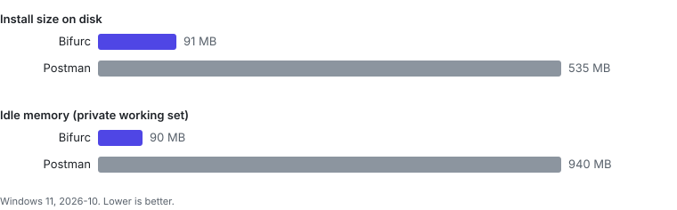

# Performance



Source: `assets/bench.json`. The current numbers are those measured for the
[Bifurc vs Postman](https://bifurc.app/compare/postman) page, on Windows 11 in October 2026: Bifurc 0.6.1 with its
proxy engine running against Postman 12.33.2, both idle after launch. Memory is the private working set, the figure
Task Manager shows. Cold start was not measured in that run.

## Reproduce

Windows:

```powershell
scripts/bench/bench.ps1 `
  -App "Bifurc|C:\Program Files\Bifurc|C:\Program Files\Bifurc\bifurc-ui.exe|bifurc-ui,bifurc-engine,bifurc-tray" `
  -App "Postman|$env:LOCALAPPDATA\Postman|$env:LOCALAPPDATA\Postman\Postman.exe|Postman"
node scripts/bench/render.mjs
```

The script closes the apps it measures. It measures install size, cold start to the first window (median of five
runs) and idle memory 30 seconds later, and writes `assets/bench.json`. An app that is not installed is left out;
nothing is estimated. On macOS and Linux, `scripts/bench/bench.sh <install folder> <ui executable>` prints install
size and idle memory for Bifurc.

Proxy throughput (`oha` against a local echo server, direct and through the capture proxy) is not measured yet.
